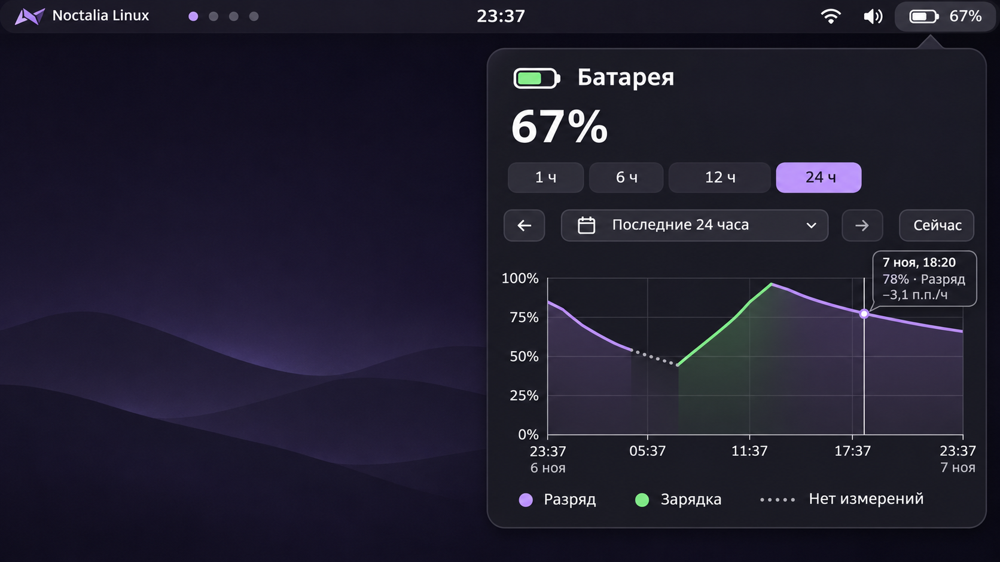

# Плагин истории заряда для Noctalia

Дата первоначального согласования: 2026-11-07. Обновление решения: 2026-11-08. Статус: первая версия реализована и подключена к штатной батарее.

## Результат

Плагин для установленной Noctalia 5.4.1: ПКМ по штатной батарее открывает панель с историей заряда. Отдельный виджет в баре не создаётся; левый клик сохраняет штатный переход в раздел питания. Цвета и оформление следуют теме Noctalia.

Изображение — ранний иллюстративный макет с вымышленными данными, а не снимок работающего плагина. Его отдельный виджет в баре больше не используется. Требования ниже имеют приоритет над деталями изображения.

## Интерфейс

- Панель шириной 560 логических пикселей, ограниченная размерами экрана. Открывается в плавающем режиме, отдельно от бара, в соответствии с остальными панелями пользователя.
- Слева шкала 0–100%, снизу местное время в формате `HH:mm`. При переходе через полночь добавляется дата.
- Разряд выделяется основным цветом темы, зарядка — зелёным; под графиком легенда.
- По умолчанию при открытии показаны последние 24 часа. Доступны периоды 1, 6, 12 и 24 часа.
- Стрелки сдвигают окно на выбранный период; кнопка календаря открывает список дат за 30 дней, выбранный день показывается от полуночи до полуночи. Кнопка «Сейчас» возвращает скользящее окно выбранной длительности.
- Наведение показывает указатель, дату, время, процент и состояние батареи. При разряде дополнительно отображается скорость в п.п./ч.
- Пробелы между измерениями соединяются нейтральным пунктиром. Подсказка поясняет, что промежуточных данных нет.

## Реализация и данные

- Проект находится в папке `battery-plugin`. Основа — Luau: панель и фоновый сбор данных в рамках плагина. ПКМ назначается штатному виджету через `widget.battery.actions.right`.
- Для графика с пунктиром, цветными участками и указателем использовать `ui.pixelStream` и небольшой вспомогательный процесс Python с Cairo. Он запускается плагином для отображения графика; отдельная системная служба не нужна.
- Текущие данные получать через UPower, записывая измерение раз в минуту. При первом запуске и затем каждые шесть часов импортировать доступную историю UPower за последние 30 дней, объединяя её со своей без дубликатов.
- История хранится транзакционно в SQLite в постоянной папке данных плагина, отдельно для каждой батареи: время, заряд, состояние и источник измерения. Удаляются записи старше 30 дней. Для служебных JSON применяется временный файл и переименование.
- Пропущенные интервалы собственной записи длительнее трёх минут считать пробелами. Редкую импортированную историю показывать пунктиром там, где нет достаточных измерений; причину пробела не угадывать.
- Скорость считать по изменению заряда за 15 минут перед выбранной точкой. Нужны непрерывные измерения разряда за всё окно; при зарядке, пробеле или недостатке данных — «нет оценки».
- Предусмотреть состояния «Истории пока нет», «Батарея не найдена» и «UPower недоступен». Ошибки чтения не должны заменять заряд нулём.
- Добавлены манифест, инструкции установки и описание зависимостей. Плагин подключён локальной ссылкой и включён; ПКМ штатной батареи назначен открытию панели после проверки реализации.

## Проверка

- Проверить расчёты периодов, переход через полночь, выбор прошлых дней и возврат к текущему времени.
- Проверить зарядку, разряд, постоянный заряд, пробелы, единичное измерение и пустую историю.
- Проверить скорость на известных данных, исключение зарядки и пробелов из расчёта.
- Проверить импорт UPower, устранение дубликатов, восстановление после перезапуска и удаление старых записей.
- Выполнить `noctalia plugins lint`; проверить реальную панель, читаемость осей, наведение, смену темы и масштабирование.

## Принятые ограничения

Первая версия предназначена для Noctalia 5.4.1 и системной батареи ноутбука. Интерфейс — русский. История хранится 30 дней, сбор работает вместе с Noctalia. Управление питанием, прогноз автономности, график ватт и публикация в каталоге плагинов в эту версию не входят.

## Источники технической информации

- [Плагины Noctalia 5.4.1: интерфейс](https://docs.noctalia.dev/noctalia/v5.4.1/plugins/development/declarative-ui/).
- [Плагины Noctalia 5.4.1: API выполнения и постоянное хранение](https://docs.noctalia.dev/noctalia/v5.4.1/plugins/development/runtime-api/).
- Локально проверены версия `noctalia`, наличие UPower и получение истории BAT0 через D-Bus, доступность Python и Cairo.
